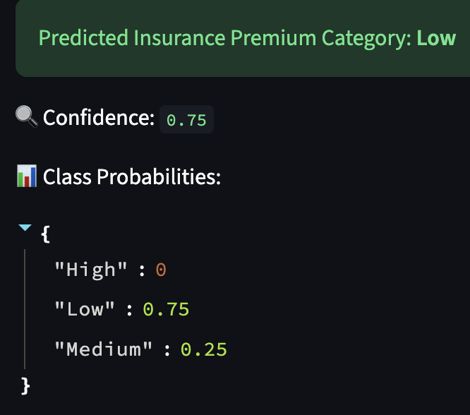

# Insurance Premium Category Prediction


An end-to-end ML app: a trained model served through a **FastAPI** backend with validated inputs, plus a **Streamlit** frontend. It returns the predicted premium category along with the model's confidence and class probabilities.

## What it does

Takes a person's profile and predicts their insurance premium category (Low, Medium or High).

**Inputs:** age, weight (kg), height (m), annual income (LPA), smoker (yes/no), city, occupation

**Derived features (computed automatically):**
- `bmi` from weight and height
- `age_group` (young, adult, middle_aged, senior)
- `lifestyle_risk` (low, medium, high) from smoking status and BMI
- `city_tier` (1, 2, 3) from the city

Inputs are validated with Pydantic (value ranges, allowed occupations), so bad requests are rejected before they reach the model.

## Tech stack

Python, FastAPI, Pydantic, scikit-learn, pandas, Streamlit

## Project structure

| File | Purpose |
|---|---|
| `App.py` | FastAPI app, input validation, feature engineering, `/predict` endpoint |
| `Frontend.py` | Streamlit UI |
| `Fastapi_ml_models.py` | Model experiments |
| `model.pkl` | Trained model |
| `insurance.csv` | Training data |

## Run locally

```bash
git clone https://github.com/kaseraaryan5-star/learning-fastapi.git
cd learning-fastapi
pip install -r requirements.txt

# Terminal 1: backend
uvicorn App:app --reload

# Terminal 2: frontend
streamlit run Frontend.py
```

The API docs are available at `http://127.0.0.1:8000/docs`. To point the frontend to a different backend, set the `API_URL` environment variable.

## Example request

```bash
curl -X POST http://127.0.0.1:8000/predict \
  -H "Content-Type: application/json" \
  -d '{
    "age": 30,
    "weight": 65,
    "height": 1.7,
    "income_lpa": 10,
    "smoker": false,
    "city": "Mumbai",
    "occupation": "private_job"
  }'
```

Response:

```json
{
  "response": {
    "predicted_category": "Low",
    "confidence": 0.75,
    "class_probabilities": {
      "High": 0.0,
      "Low": 0.75,
      "Medium": 0.25
    }
  }
}
```

## Next steps

- [ ] Dockerize the app
- [ ] Add PyTest tests for the API
- [ ] Add model evaluation metrics to this README